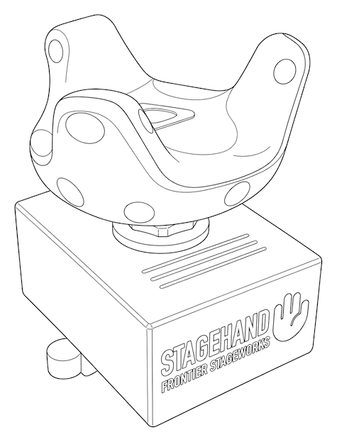

# Stagehand Public Files

Stagehand is a camera tracking appliance for virtual production, leveraging lighthouse-based tracking. It delivers professional camera tracking and FIZ (focus, iris, zoom) capture in one compact, field-capable unit — send data live or record the camera move for later, without building the shoot around a dedicated tracking workstation.

Learn more at [www.frontierstageworks.com](https://www.frontierstageworks.com).

**Stagehand is currently in beta, with general launch coming soon.**

This repository hosts public Stagehand files, including client software, agent updates, and documentation.

Download the latest macOS and Windows beta clients here: https://github.com/Frontier-Stageworks/stagehand/releases

 

